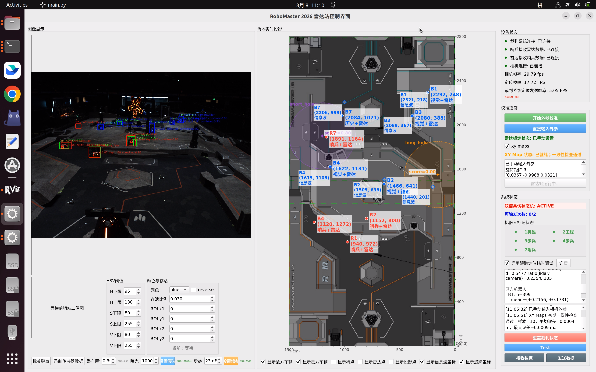

# RM2026 相机与激光雷达融合定位算法
<p align="center">
  
</p>
本开源空间包含比赛实际使用的相机识别、激光雷达定位、点云聚类和视觉—点云融合代码，以及运行所需的模型、场地资源和配置。

本开源提供除信息波/干扰波解析算法和激光云台自动瞄准程序外的所有功能。Python 主程序保留裁判系统、信息波结果和自瞄通信的接口，默认关闭信息波坐标覆盖与机器人摘要转发；没有外部信息波或自瞄程序时，不影响视觉与点云融合定位。

## 目录

- `Lidar_ws/`：ROS2 激光雷达定位、动态点云提取和聚类。
- `Main_ws/`：相机检测、装甲板和数字识别、目标跟踪、视觉—点云融合与 UI。
- `docs/`：本开源空间的算法原理、主程序数据流、示意图和演示图片。
- `recordings/replay_sample/`：配套网盘数据解压位置，用于同步回放复现，不纳入 Git 源码仓库。
- `tools/synchronized_replay.py`：相机录像与 rosbag 同步回放。
- `record.sh`：Livox rosbag 与屏幕录制辅助脚本。
- `start_fusion.sh`：只启动激光雷达与 Python 融合主程序。
- `OPEN_SOURCE_CONTENTS.md`：开源内容、运行资源和排除项清单。

## 国赛设备

- 相机：海康 MV-CS120-10UC
- 激光雷达：Livox HAP
- 运算平台：RTX 5090 + Intel Core Ultra 9 275HX 笔记本

## 效果演示



## 算法介绍

- [主程序数据流说明](docs/主程序数据流说明.md)
- [融合定位算法说明](docs/融合定位算法说明.md)

## 算法配置文件说明

| 配置文件 | 作用 |
| --- | --- |
| `Main_ws/config/params.yaml` | 模型、识别阈值、目标跟踪与融合定位参数。 |
| `Main_ws/config/device.yaml` | 相机采集参数、内参、畸变系数及雷达到相机外参。 |
| `Main_ws/config/guess_pts.yaml` | 目标跟踪丢失时使用的场地候选位置。 |
| `Main_ws/config/botsort.yaml`、`bytetrack.yaml` | 车体检测器使用的跟踪器参数。 |
| `Lidar_ws/src/rm2026_lidar_launch/config/params.yaml` | 点云配准、动态点筛选和聚类参数。 |
| `Lidar_ws/src/rm2026_lidar_launch/config/lidar_extrinsics.yaml` | Livox 雷达到场地坐标系的初始外参。 |
| `Main_ws/config/test.yaml`、`test_full.yaml` | 精简样例和完整数据的同步回放参数。 |

## 包含的比赛运行资源

- 车体检测：`weights/car/best.engine`。
- 装甲板检测：`weights/armor/armor_best.engine`。
- 数字分类：`weights/MobileNetv2.2.pth`。
- 可重新转换的 PT、ONNX 权重文件。
- Python 射线投影地图：`field/RMUC2026.ply`。
- UI 场地图：`field/field_image.PNG`。
- ROS2 定位地图：`Lidar_ws/src/dynamic_cloud/config/RMUC2026.pcd`。
- 相机、雷达外参与融合参数。

TensorRT engine 与生成它的 GPU 架构、CUDA 和 TensorRT 版本有关。如果目标机器不兼容，应使用同目录下的 PT/ONNX 文件重新转换。

## 环境依赖

- Ubuntu 22.04、ROS2 Humble。
- 独立安装并构建的 `livox_ros_driver2` 工作空间，默认位于本项目同级的 `livox_ws/`；也可通过 `LIVOX_WS_DIR` 指定。
- CUDA、TensorRT、Python 3.10，以及 `requirements.txt` 中的 Python 包。
- 海康 MVS 相机 SDK。仓库包含 Python 封装，不包含厂商运行库。
- ROS2 侧还需要 PCL、`ndt_omp`、`pcl_conversions` 等各 `package.xml` 声明的依赖。

## 构建

```bash
source /opt/ros/humble/setup.bash
source ../livox_ws/install/setup.bash
cd Lidar_ws
./build.sh
```

Livox 工作空间不在默认位置时：

```bash
export LIVOX_WS_DIR=/path/to/livox_ws
```

## 运行

先检查以下配置：

- `Main_ws/config/device.yaml`：相机分辨率、曝光、增益和内参。
- `Main_ws/config/params.yaml`：模型、融合、场地、外参和裁判串口配置。
- `Lidar_ws/src/rm2026_lidar_launch/config/params.yaml`：点云地图、配准和聚类参数。
- `Lidar_ws/src/rm2026_lidar_launch/config/lidar_extrinsics.yaml`：Livox 外参。

启动融合定位：

```bash
./start_fusion.sh
```

可用环境变量：

```bash
CONDA_ENV=cud128 LAUNCH_RVIZ=false LIVOX_WS_DIR=/path/to/livox_ws ./start_fusion.sh
```

## 回放验证

项目配套提供精简样例和完整录制两组数据，不纳入 Git 源码仓库：

- `replay_sample`：约 7 秒，用于快速检查环境和启动流程。
- `full_replay_20260808_153910`：约 9.9 分钟有效同步数据，用于完整复现融合定位流程。

下载后将数据目录放到 `recordings/` 下，最终应出现：

```text
recordings/replay_sample/camera/camera_record.mp4
recordings/replay_sample/rosbag_livox_lidar/metadata.yaml
recordings/full_replay_20260808_153910/camera/camera_record.mp4
recordings/full_replay_20260808_153910/rosbag_livox_lidar/metadata.yaml
```

`Main_ws/config/test.yaml` 指向精简样例；`Main_ws/config/test_full.yaml` 指向完整录制。完整录制包含 17,028 帧原分辨率相机图像、12,828 帧 `/livox/lidar` 点云以及录制时的相机内外参，相机时间段完全位于 rosbag 覆盖范围内。

先进行只读预检，确认相机和点云时间范围存在交集：

```bash
./run_replay_test.sh Main_ws/config/test.yaml --preflight-only
```

完整数据预检：

```bash
./run_replay_test.sh Main_ws/config/test_full.yaml --preflight-only
```

预检通过后启动完整回放：

```bash
./run_replay_test.sh Main_ws/config/test.yaml
```

完整数据回放：

```bash
./run_replay_test.sh Main_ws/config/test_full.yaml
```

主界面出现后导入回放工具提示的外参文件，再点击“启动雷达站”。ROS 点云管线和相机回放会从首个共同时间戳同时开始。播放结束后界面默认保留，关闭界面或在启动终端按 `Ctrl+C` 退出。

各数据目录内的 `README.md`、`source_info.yaml` 和 `SHA256SUMS` 记录了来源、统计与完整性信息。替换成自己的数据时，只需复制一份测试配置并修改 `rosbag_path` 和 `camera_session_dir`。

## 外部接口

- 点云输入：`/livox/lidar`。
- 聚类输出和 Python 融合输入：`/livox/lidar_cluster`。
- 裁判串口默认：`/dev/referee`，没有设备时通信管理器会重试，不影响算法代码加载。
- 信息波与自瞄仅保留通信接口，本空间不提供其解析或执行程序。

## 感谢
感谢香港科技大学ENTERPRIZE战队RoboMaster 2025雷达站算法开源、
东北大学T-DT战队RoboMaster 2025雷达站算法开源。
