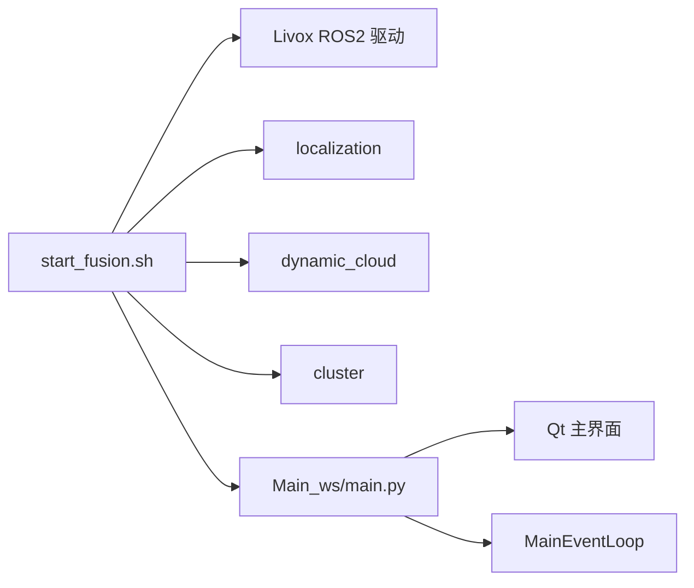
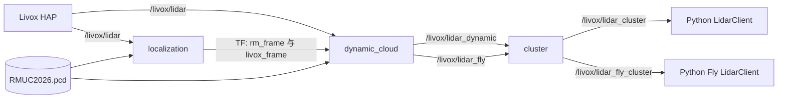
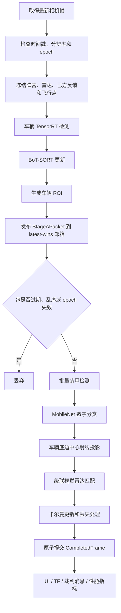

# 主程序流程与数据流说明

本文从程序运行角度说明开源融合定位系统的进程关系、线程关系、输入输出以及单帧处理过程。算法原理见同目录下的《融合定位算法说明》。

## 1. 启动关系

开源空间的统一入口为：

```bash
./start_fusion.sh
```

启动脚本依次完成：

1. 加载 ROS 2 Humble 环境；
2. 加载 Livox 驱动工作空间；
3. 加载 `Lidar_ws/install/setup.bash`；
4. 后台启动 `rm2026_lidar_launch/lidar_pipeline.launch.py`；
5. 激活 Python Conda 环境；
6. 进入 `Main_ws`，执行 `run_scripts/run.sh`。

整体进程关系如下：



## 2. ROS 2 点云管线



各节点职责如下：

| 节点 | 输入 | 输出 | 作用 |
|---|---|---|---|
| `localization` | 原始点云、场地 PCD | TF、调试点云 | 估计雷达在场地中的位姿 |
| `dynamic_cloud` | 原始点云、TF、场地 PCD | 动态点云、飞行点云 | 坐标转换、ROI 过滤、静态地图扣除和多帧累积 |
| `cluster` | 动态点云、飞行点云 | 地面和飞行聚类中心 | 将点云目标压缩成候选中心点 |

`dynamic_cloud` 和 `cluster` 在定位节点启动后按配置延时启动，以减少定位尚未就绪时产生的无效动态点。

## 3. Python 主程序初始化

`Main_ws/main.py` 是 Python 入口，初始化顺序为：

1. 读取 `config/device.yaml` 和 `config/params.yaml`；
2. 初始化 ROS 2 `rclpy`；
3. 根据配置创建真实相机、图片源、ROS 图像源或同步回放相机；
4. 创建裁判系统通信管理器；
5. 创建 `MainEventLoop`；
6. 在 `MainEventLoop` 中创建两个 ROS 点云订阅客户端；
7. 加载车辆、装甲和数字模型；
8. 创建级联跟踪器并进行模型预热；
9. 启动相机采集；
10. 进入 Qt 主界面事件循环。

Qt 界面启动定位功能后调用 `MainEventLoop.run()`。检测流水线开启时，它创建 A、B 两个处理线程；点云订阅、裁判通信和异步可视化还拥有各自线程。

## 4. 主要运行线程

| 线程或执行器 | 生产数据 | 消费数据 | 是否阻塞定位 |
|---|---|---|---|
| 相机采集线程 | 最新图像和时间戳 | 流水线 A | 获取图像设有超时 |
| 地面点云 ROS 执行器 | 最新地面聚类快照 | 流水线 A | 否，锁内复制快照 |
| 飞行点云 ROS 执行器 | 最新飞行聚类点 | 流水线 A | 否 |
| 流水线 A | 车辆检测结果和同源状态包 | latest-wins 邮箱 | 只覆盖旧待处理包 |
| 流水线 B | 装甲识别、融合和跟踪快照 | UI、TF、裁判消息 | 状态更新串行提交 |
| 异步可视化线程 | 带框图像 | Qt UI | 否，只保留最新任务 |
| 裁判通信线程 | 阵营、己方反馈、串口输出 | A 阶段及裁判系统 | 与定位线程解耦 |

## 5. 单帧数据包

A 阶段从相机取得一帧后，在相近时刻冻结以下数据：

- 图像及图像时间戳；
- 输入分辨率、流水线 epoch 和源帧序号；
- 当前阵营；
- 最新地面雷达聚类快照及其接收时间；
- 最新飞行雷达点；
- 最新己方机器人位置反馈；
- 前哨站 ROI 存活判断；
- 车辆检测框、置信度、BoT-SORT ID 和车辆 ROI；
- 各模块运行耗时。

这些数据封装为只读 `StageAPacket`。B 阶段处理该包时不再读取一份更新后的雷达点或阵营，从而避免把不同时间取得的状态随意拼接到同一输出帧。

## 6. A/B 两级视觉与融合流水线



### 6.1 A 阶段

A 阶段负责低延迟接纳相机帧和车辆检测：

1. `camera.get_image_latest()` 只取得最新帧；
2. 分辨率变化或时间戳明显回退时递增 epoch，使旧数据包失效；
3. 冻结雷达、阵营和己方反馈快照；
4. 执行车辆检测与 BoT-SORT；
5. 裁剪车辆 ROI；
6. 发布到 latest-wins 邮箱。

如果 B 阶段尚未取走上一包，新包会覆盖旧包。系统因此优先保持低延迟，而不是保证每帧都被处理。

### 6.2 B 阶段

B 阶段负责计算量更大的语义识别和融合：

1. 检查关闭状态、epoch、顺序和数据年龄；
2. 对所有车辆 ROI 批量执行装甲与数字识别；
3. 装甲模型异常时保留车辆框和 BoT-SORT ID，继续执行退化跟踪；
4. 将检测结果转换成 `CarObservation`；
5. 再次检查数据年龄；
6. 在状态锁内执行级联匹配和卡尔曼更新；
7. 构造不可变 `CompletedFrame`；
8. 原子替换当前最新输出。

当前 `detection_pipeline.max_commit_age_sec` 为 0.20 秒。超过该年龄的数据不会更新跟踪状态或下游位置。

## 7. 融合状态机数据流

输入到跟踪状态机的数据包括：

```text
CarObservation[]
    ├─ 车辆框和 car_confidence
    ├─ BoT-SORT bot_id
    ├─ 装甲颜色、数字和置信度
    ├─ 身份候选 class_id
    └─ 视觉射线场地点

LidarSnapshot
    ├─ 地面聚类中心 (x, y)
    └─ received_monotonic

AllySnapshot
    ├─ 己方各机器人反馈位置
    └─ received_monotonic
```

状态机依次执行：

```text
雷达快照有效性与阵营镜像
  → 所有位置卡尔曼预测
  → BoT-SORT 身份历史更新
  → 己方反馈匹配
  → 彩色装甲三元组匹配
  → 灰甲身份维持
  → 敌方历史轨迹—雷达匈牙利匹配
  → 灰甲模糊匹配
  → 纯雷达猜测
  → 未匹配目标退化处理
  → 输出有效性整理
```

蓝方运行时，雷达坐标按照 `field_length - x`、`field_width - y` 镜像，使后续算法始终使用统一的阵营视角。

## 8. 输出快照与下游消费者

成功提交的 `CompletedFrame` 包含：

- 原始图像和源时间戳；
- 本帧视觉检测结果；
- 10 个机器人跟踪状态；
- 有效地面雷达点及真实身份匹配关系；
- 视觉投影点；
- 飞行雷达点；
- 10 个机器人厘米坐标快照；
- A、B 阶段和端到端耗时；
- 提交序号、帧间隔和错误信息。

提交后再交给下游消费者，慢速 UI 或日志不能反向阻塞融合状态事务：

1. 异步生成检测和跟踪叠图；
2. 发布调试目标 TF 和 PoseArray；
3. 更新裁判系统 `Radar2ClientMessage`；
4. 更新 UI 展示所需的位置、来源和 FPS；
5. 异步写入性能指标。

地面机器人位置来自融合跟踪器。飞行目标不经过地面机器人身份匹配，直接由 `/livox/lidar_fly_cluster` 转换为厘米坐标，作为空中机器人位置输入。

## 9. 输出身份和状态

跟踪器维护 10 个正式身份：

| class_id | 身份 |
|---:|---|
| 0～4 | `B1、B2、B3、B4、B7` |
| 5～9 | `R1、R2、R3、R4、R7` |

每个目标输出包含：

- `identity_state`：未见、猜测或已确认；
- `spatial_state`：未初始化、跟踪、短时续航或丢失；
- `frame_source`：本帧位置来源；
- `output_position_2d_m`：场地二维坐标；
- `output_valid`：当前位置是否允许下游使用；
- `is_guessed_output`：是否为猜测结果。

主要位置来源包括：

| 来源 | 含义 |
|---|---|
| `CAMERA_LIDAR` | 彩色视觉身份与雷达点融合 |
| `GRAY_CAMERA_LIDAR` | 灰甲维持已确认身份 |
| `ALLY_FEEDBACK` / `ALLY_LIDAR` | 己方反馈及雷达验证 |
| `LIDAR_HISTORY` | 历史轨迹与雷达续接 |
| `GRAY_RADAR_GUESSED` | 灰甲阵营模糊猜测 |
| `RADAR_GUESSED` | 纯雷达点猜测 |
| `KF_PREDICTED` | 卡尔曼短时预测 |
| `FIXED_GUESSED` | 长期丢失后的固定点回退 |

## 10. 时间一致性和退化规则

当前系统采用最新快照软同步，不是严格的 ROS 多话题时间同步：

- 相机帧到达时读取最新雷达快照；
- 雷达快照超过 0.20 秒不参与融合；
- 数据包处理总年龄超过 0.20 秒不允许提交；
- 邮箱只保留最新待处理帧；
- 图像时间戳回退或分辨率变化会使旧 epoch 数据失效；
- 装甲识别异常时仍保留车辆观测和历史轨迹；
- 雷达暂时失效时，已有敌方目标可以短时使用卡尔曼预测；
- UI、TF 或指标发布异常不会终止融合主循环。

## 11. 代码索引

| 数据流环节 | 文件 |
|---|---|
| 一键启动 | `start_fusion.sh` |
| ROS 点云管线启动 | `Lidar_ws/src/rm2026_lidar_launch/launch/lidar_pipeline.launch.py` |
| 点云定位 | `Lidar_ws/src/localization/src/localization.cpp` |
| 动态点提取 | `Lidar_ws/src/dynamic_cloud/src/dynamic_cloud.cpp` |
| 聚类中心生成 | `Lidar_ws/src/cluster/src/cluster.cpp` |
| Python 程序入口 | `Main_ws/main.py` |
| 主事件循环 | `Main_ws/main_event_loop.py` |
| 点云 ROS 客户端 | `Main_ws/driver/lidar/ros2_lidar_client.py` |
| 视觉检测 | `Main_ws/tracker/CascadeMatchTracker/detector.py` |
| 融合跟踪 | `Main_ws/tracker/CascadeMatchTracker/tracker.py` |
| 流水线数据结构 | `Main_ws/tracker/CascadeMatchTracker/pipeline.py` |
| 运行参数 | `Main_ws/config/params.yaml` |
