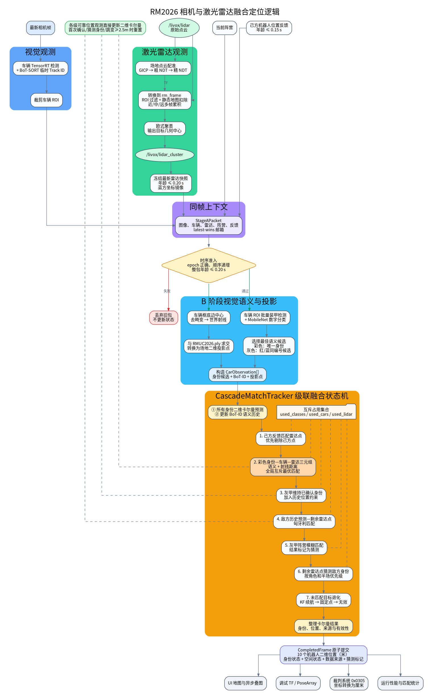

# 相机与激光雷达融合定位算法说明

本文说明当前开源版本中的四个核心算法模块：激光雷达点云配准、动态点云筛选、视觉识别定位，以及视觉与激光雷达识别结果融合。

## 1. 坐标系与输入输出

系统使用以下主要坐标和数据：

- `/livox/lidar`：Livox 驱动发布的原始点云。
- `livox_frame`：激光雷达坐标系。
- `rm_frame`：比赛场地全局坐标系，单位为米。
- `/livox/lidar_cluster`：地面动态目标聚类中心。
- `/livox/lidar_fly_cluster`：飞行目标聚类中心。
- 相机图像：用于检测车辆、装甲颜色和机器人数字。
- `RMUC2026.pcd`：激光雷达配准与静态背景扣除使用的场地点云地图。
- `RMUC2026.ply`：相机射线与场地表面求交使用的三维网格。

地面机器人融合结果统一表示为 `rm_frame` 下的二维坐标 `(x, y)`。发送给裁判系统前再由米转换为厘米。

## 2. 激光雷达点云配准

### 2.1 目的

激光雷达测得的原始点位于雷达自身坐标系。配准模块估计雷达相对场地地图的位姿，使后续点云能够转换到统一的 `rm_frame`，从而与相机投影点和裁判系统坐标进行比较。

### 2.2 配准输入

定位节点读取：

- 实时点云 `/livox/lidar`；
- 静态场地地图 `Lidar_ws/src/dynamic_cloud/config/RMUC2026.pcd`；
- `Lidar_ws/src/rm2026_lidar_launch/config/lidar_extrinsics.yaml` 中的初始外参；
- `Lidar_ws/src/rm2026_lidar_launch/config/params.yaml` 中的定位参数。

当前配置启用 `gicp_ndt` 后端，一次完整配准依次执行：

```text
实时点云累积/背景筛选
        ↓
体素下采样
        ↓
粗 GICP
        ↓
细 NDT
        ↓
精 NDT
        ↓
跳变检查、平滑和位姿发布
```

GICP 经过大量实验能够提供了良好的初步位姿，但由于基于硬匹配的优化函数性质不够良好，匹配过程总会收敛在和实际点云平均相差10-20cm的位置。
NDT 基于局部概率密度求取极大似然，其性质极其良好，但细粒度的 NDT 依赖初值。
注：也可以采用极大粒度的 NDT 依次降粒度。但由于前期一直使用 GICP ，故为了比赛稳定性仍然保留使用 GICP 提供初值。


### 2.3 背景点云与位姿约束

当前配置启用持久背景筛选。节点按方位角和俯仰角划分栅格，优先保留较远、稳定的背景点，降低近处机器人遮挡对配准的影响。

候选位姿还会经过以下检查：

- 配准结果必须为有限数值；
- 使用 fitness 评估地图对齐质量；
- 限制相邻结果的最大平移和旋转跳变；
- 使用 `transform_smooth_alpha` 对位姿进行平滑；
- 雷达位置明显变化时，可自动重建背景并重新配准。

最终结果通过 TF 提供 `rm_frame` 与雷达坐标系之间的变换。动态点云模块依赖该 TF；TF 不可用时，本帧点云会被直接放弃。

## 3. 动态点云筛选与聚类

### 3.1 全局坐标转换和 ROI 过滤

`dynamic_cloud` 接收 `/livox/lidar` 后，首先通过 TF 将点云转换到 `rm_frame`。随后执行空间过滤：

1. 删除飞镖区、基地、大福等手动标记的干扰区域；
2. 删除几个国赛实际场地和建模时不同的区域；
3. 主场地外仅保留飞行目标相关区域的点；
4. 根据高度范围排除地面和无关结构。
5. 主场地 ROI 内的点进入地面动态目标检测；

这些 ROI 均在 `Lidar_ws/src/rm2026_lidar_launch/config/params.yaml` 中配置。

### 3.2 静态地图扣除

静态地图经过体素下采样后建立 KD-Tree。对实时点云中的每个点 `p`，查询其在地图中的最近邻 `q`，计算平方距离：

```text
d² = ||p - q||²
```

当 `d²` 大于所在区域的阈值时，该点被认为不属于静态地图，作为动态点保留。当前近、中、远区域分别使用独立阈值，以适应不同距离下的点云密度和测量误差。

### 3.3 分区累积
为确保雷达点聚类准确性，将动态点按场地位置分为近端、中间和远端，每个点只进入一个区域缓存。当前配置分别累积：

| 区域 | 累积帧数 | 主要作用 |
|---|---:|---|
| 近端 | 3 | 减少高密度点云的运动拖影 |
| 中间 | 6 | 平衡响应速度和点云密度 |
| 远端 | 6 | 补充远距离稀疏点 |

多帧累积能提高聚类稳定性，但目标高速运动时会产生一定拖尾，因此聚类中心并不等同于机器人几何中心。

### 3.4 欧式聚类

`cluster` 节点分别处理近、中、远区域，使用各自的聚类容差和最小点数执行欧式聚类。每个聚类输出一个几何中心：

```text
P_center = (1 / N) × Σ P_i
```

地面目标中心发布到 `/livox/lidar_cluster`，飞行目标中心发布到 `/livox/lidar_fly_cluster`。Python 主程序接收的是这些聚类中心，而不是完整点云。

## 4. 视觉识别与定位

### 4.1 两级视觉检测

视觉检测分为两个阶段：

1. 车辆检测：车辆 TensorRT 模型在完整图像上检测车辆；
2. 装甲识别：裁剪每个车辆 ROI，批量执行装甲板检测和 MobileNet 数字分类。

当前装甲语义类别为：

```text
B1 B2 B3 B4 B7
R1 R2 R3 R4 R7
G1 G2 G3 G4 G7
```

`B/R/G` 分别表示蓝色、红色和灰色装甲。数字 `1/2/3/4/7` 分别对应英雄、工程、3 号、4 号和哨兵。

装甲候选的组合置信度为：

```text
C_combined = 0.70 × C_digit + 0.30 × C_armor
```

低于数字置信度或组合置信度阈值的候选不会作为身份锚点。一个车辆存在多个候选装甲时，选择组合置信度最高的有效候选。

### 4.2 从像素生成场地投影点

系统取车辆框底边中心 `(u, v)`，作为车辆与地面的接触点近似：

```text
u = (x1 + x2) / 2
v = y2
```

投影过程为：

1. 使用相机畸变参数校正像素；
2. 使用相机内参矩阵 `K` 的逆矩阵生成相机射线；
3. 使用外参 `R、t` 将射线转换到世界坐标；
4. 射线与 `field/RMUC2026.ply` 三维场地网格求交；
5. 将交点转换到统一比赛场地坐标。

视觉投影点主要用于约束“某辆车应该匹配哪个雷达聚类点”。融合成功后，最终位置通常使用雷达测量，而不是直接使用视觉投影点。

当前 `ray_projection.xy_maps_default_enabled` 为 `false`，因此默认执行实时射线与网格求交；代码同时保留预计算 XY Map 的加速接口。

## 5. 识别结果融合



注：原本希望使用激进的(历史, 视觉, 雷达)三元组的融合匹配。但是限于开发时还没有足够好的数据难以调试，故退而使用稳定性更高的分阶段匹配。由于信息波解得过于稳定，所以直接使用信息波，而不考虑融合信息波。


### 5.1 融合目标

视觉观测能够给出装甲颜色、数字、车辆框，但视觉投影距离受标定误差和地形模型影响。雷达聚类点能提供较稳定的全局位置，却不能直接判断机器人身份。

考虑到相比于相机平面，场地平面的距离度量天然一致且良好，也可以自然地使用卡尔曼滤波的结果。故我们将匹配过程的距离度量放于场地平面上。

由于配准后的雷达点准确且稳定，故该融合算法旨在尽可能地利用雷达点。

### 5.2 每帧级联顺序

跟踪器每帧按照以下顺序处理，前级已占用的身份、车辆或雷达点不会被后级重复使用：

1. 二维卡尔曼滤波器预测所有已有目标的位置；
2. 使用新鲜的己方哨兵反馈匹配并剔除己方雷达点；
3. 对彩色装甲执行视觉—雷达匹配；
4. 对于未匹配的，使用无法确认阵营灰色装甲进行模糊匹配；
5. 对于仍未匹配的，将敌方历史预测位置与剩余雷达点做匈牙利匹配；
6. 对仍未匹配的目标执行卡尔曼续航、固定点回退或无效化。
7. 对长期丢失的敌方目标，使用剩余雷达点猜测；

### 5.3 彩色装甲匹配代价

由于可能存在多个框对应于同一个 id 的情况，故构建三元组

```text
机器人身份 class_id + 视觉车辆 car + 雷达点 lidar
```

彩色装甲能够唯一确定红蓝阵营和机器人编号。候选匹配必须满足视觉投影点与雷达点距离不超过配置门限，当前为 1.5 米。其代价由以下因素组成：

- 视觉投影点到雷达点的距离；
- 装甲与数字组合置信度；

所有候选通过互斥求解，优先获得匹配数量更多且总代价更小的组合。

注：后续发现，训练好的模型在合适的阈值下并没有出现多个视觉框指向同一个 id 的情况，故实际情况恰好退化为了二元组，可以改为匈牙利匹配。但由于其本身时间代价已经极小，为了稳定性仍保留。

### 5.4 灰色装甲和历史续接

灰色装甲只有机器人编号，无法确定阵营。例如 `G1` 同时对应 `B1` 和 `R1`。对于已确认轨迹，系统结合以下信息维持身份：

- 装甲识别置信度。
- 卡尔曼预测位置与雷达点距离；
- 视觉投影点与雷达点距离；

视觉暂时失效时，已有敌方轨迹仍可通过预测位置与雷达点的匈牙利匹配继续更新。

### 5.5 位置滤波和退化行为

可靠匹配得到的雷达坐标用于更新二维卡尔曼滤波器。首次确认、原身份为猜测，或新测量与预测相差达到 2.5 米时会重新初始化位置滤波器，避免旧轨迹错误拖拽新目标。

未匹配目标按照以下方式退化：

- 短时丢失：继续输出卡尔曼预测位置；
- 达到 10 帧：允许使用未分配雷达点重新猜测敌方位置；
- 达到 30 帧：根据 `config/guess_pts.yaml` 输出固定回退点；
- 己方目标没有新鲜反馈时，不参与随机分配。

每个输出都携带来源和是否猜测标记，使 UI 和下游模块能够区分可靠融合、历史续接与回退结果。

## 6. 关键实现文件

| 模块 | 文件 |
|---|---|
| 激光雷达配准 | `Lidar_ws/src/localization/src/localization.cpp` |
| 动态点筛选 | `Li