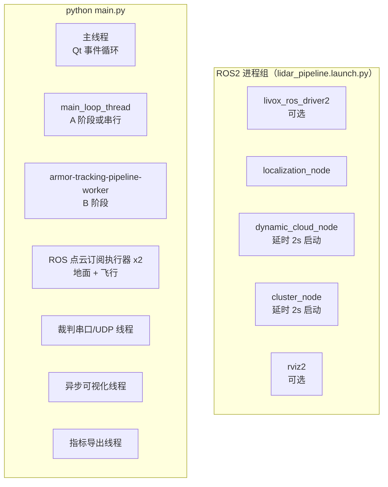
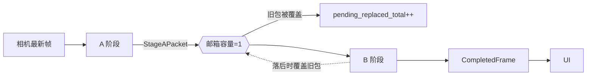
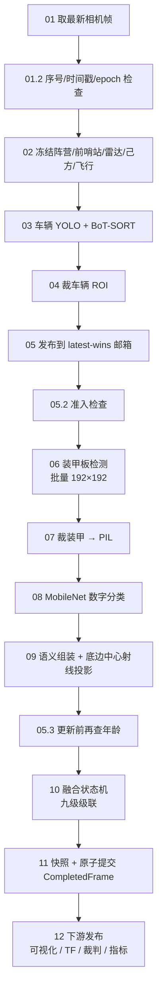

# 02 · 架构与数据流

这篇回答：**系统里有几个执行体、谁给谁喂数据、一帧相机图从进入到输出经历了什么。**

对应代码：`Main_ws/main.py`、`main_event_loop.py`、`tracker/CascadeMatchTracker/pipeline.py`。

## 1. 进程与线程模型

一次 `./start_fusion.sh` 会拉起 **1 个 ROS2 launch 进程组 + 1 个 Python 进程**。



线程的划分意图很明确：**能并行的都并行，但共享状态的提交必须串行**。

| 执行体 | 生产 | 消费 | 是否阻塞定位主链路 |
|---|---|---|---|
| 相机采集线程（驱动内部） | 最新图像 + 时间戳 | A 阶段 | 取图有超时（默认 0.10 s） |
| 地面点云 ROS 执行器 | `LidarSnapshot` | A 阶段 | 否，锁内复制快照 |
| 飞行点云 ROS 执行器 | 飞行点 xyz | A 阶段 | 否 |
| A 阶段线程 | `StageAPacket` | latest-wins 邮箱 | 只覆盖旧包，不等待 |
| B 阶段线程 | `CompletedFrame` | UI / TF / 裁判 / 指标 | 状态更新串行提交 |
| 异步可视化线程 | 带框图 | Qt UI | 否，只保留最新任务 |
| 裁判通信线程 | 阵营、己方反馈 | A 阶段 / 串口输出 | 与定位线程解耦 |

## 2. ROS2 话题表

这是把 ROS2 侧和 Python 侧拼起来的接线图，**对照这张表读 C++ 代码最省事**：

| 话题 | 发布者 | 订阅者 | 内容 |
|---|---|---|---|
| `/livox/lidar` | Livox 驱动 | localization、dynamic_cloud | 原始点云，`livox_frame` |
| `/livox/lidar_dynamic` | dynamic_cloud | cluster | 地面动态点（近+中+远累积），`rm_frame` |
| `/livox/lidar_other` | dynamic_cloud | （调试） | 主场地外的点 |
| `/livox/lidar_fly` | dynamic_cloud | cluster | 飞行目标点，`rm_frame` |
| `/livox/lidar_cluster` | cluster | Python `LidarClient` | **地面目标聚类中心** |
| `/livox/lidar_fly_cluster` | cluster | Python `LidarClient` | **飞行目标聚类中心** |
| `/livox/map` | localization | RViz | 静态地图，10s 一次 |
| `/filter_map`、`/livox/registration_source` | localization | RViz | 配准输入点云（调试利器） |
| `/lidar_detect` | dynamic_cloud | （预留） | `RadarWarn`：飞镖/飞行器状态 |
| TF `rm_frame → livox_frame` | localization | dynamic_cloud | **关键依赖** |

有两个容易忽略的细节：

- **TF 是硬依赖**。`dynamic_cloud.cpp` 里 `lookupTransform` 失败会直接 `return`，即这一帧点云整个被丢弃（不是降级处理）。所以 localization 挂了 = 雷达链路全断。
- **Python 拿到的不是点云**，是 `cluster` 输出的「每个聚类一个中心点」的 `PointCloud2`。`ros2_lidar_client.py` 把它读成 `(x, y)` 列表并缓存最新快照——融合层的输入侧极轻。

## 3. 启动链路（Python 侧）

`main.py` 的顺序值得记一下，因为出问题时按这个顺序排查最快：

```text
读 params.yaml + device.yaml
  → rclpy.init()
  → 按 debug.camera_mode 造相机（camera / image / ros / replay）
  → 造 RefereeCommManager（裁判串口）
  → 造 MainEventLoop
      → 造两个 LidarClient（地面 + 飞行）并起线程
      → 造 PixelToWorld（加载 RMUC2026.ply 场地网格）
      → 造 CascadeMatchTracker（加载三个模型）
      → tracker.warmup(10)   ← 用固定图跑 10 次，预热 TensorRT
      → 造 AsyncTrackingVisualizer
  → camera.start_streaming()
  → launch()  进入 Qt 主界面
```

关键点：**模型加载和预热发生在显示界面之前**，所以第一次启动会有十几秒黑屏，这是正常的。

`referee.start()` 会启动裁判串口线程；回放模式（`test.yaml` 的 `disable_referee_io: true`）下会跳过，于是没有串口也能跑。

## 4. A / B 两级流水线

这是整个项目工程上最讲究的部分。配置开关：`detection_pipeline.enabled`（默认 true）。关掉就走老的单线程串行路径 `_serial_main_loop_thread()`。

### 4.1 为什么拆两级

单帧要做四件事：车辆检测（1280×1280 输入）、装甲检测（按车辆 ROI 批量，192×192）、数字分类、融合跟踪。
在 4024×3036 的图上前两件都是重活，串行跑不出 30 FPS。拆分的思路是：

- **A 阶段（轻）**：只做「接纳帧 + 车辆检测 + BoT-SORT + 裁 ROI」，尽量跟上相机节奏。
- **B 阶段（重）**：装甲/数字识别 + 融合。计算量大，但可以落后一两帧。

两者之间用**容量为 1 的 latest-wins 邮箱**（`pipeline.py::LatestPacketMailbox`）解耦：



设计取舍写在 `publish_latest()` 的注释里：**发布永不等待消费者**。如果 B 还没取走上一包，新包直接覆盖——系统选择「保持低延迟、不保证每帧都被处理」。

### 4.2 单帧数据包 StageAPacket

A 阶段在**同一时刻**冻结下列数据，打包成不可变的 `StageAPacket`：

- 图像（只读视图 `frame.view(); flags.writeable = False`）与时间戳、分辨率
- 流水线 `epoch`、源帧序号 `source_sequence`
- 当前阵营 `faction`
- 地面雷达快照 `lidar_snapshot`（含 `received_monotonic`）
- 己方哨兵位置快照 `ally_snapshot`
- 飞行目标点 `lidar_fly_points`
- 前哨站存活判断 `outpost_alive`
- 车辆检测结果 `cars`（含每个车的 ROI 只读视图 + BoT-SORT ID）

**为什么必须冻结**：如果 B 阶段处理时才去读「最新的雷达点」，那这一帧的输出就会把 t0 的图像和 t1 的雷达拼在一起。冻结保证了「同一帧内的所有观测来自同一时刻」，这是后续卡尔曼不乱跳的前提。

### 4.3 B 阶段的准入检查

B 阶段从邮箱取出包后，要连过四道检查（任一失败就丢弃并计数）：

```text
epoch 是否失效          → epoch_drop_total
source_sequence 是否乱序 → out_of_order_drop_total
包年龄是否 > 0.20 s     → stale_before_stage_b_total
  ... 完成装甲推理后，更新状态机前再查一次年龄 → stale_before_state_total
```

最后一道检查（`stale_before_state`）特别值得注意：**装甲推理可能要几十毫秒，推理前新鲜不代表推理后还新鲜**。如果在推理期间数据已经过期，就不允许写进跟踪状态，否则会用陈旧数据污染轨迹。

### 4.4 完整单帧时序



### 4.5 提交是原子的

`CompletedFrame` 构造完成后，在 `_pipeline_output_lock` 里**一次性**替换掉以下所有字段：

`_latest_pipeline_output`、`faction`、`outpost_alive`、`latest_detection_results`、`tracks`、`lidar_points_cm`、`lidar_point_owners`、`projection_points_cm`、`lidar_fly_points_cm`、`divisions_pos`。

源码注释写得很直白：「兼容字段和新快照在同一临界区内替换，UI 不会拼接不同帧」。
UI 每帧调 `get_latest_pipeline_output()` 一次性拿全，不会出现「窗口的框是第 N 帧、坐标是第 N+1 帧」这种撕裂。

## 5. 时间一致性规则

系统**不是**严格的 ROS 多话题时间同步，而是「最新快照软同步」。规则集中在这里：

| 规则 | 阈值 | 出处 |
|---|---|---|
| 雷达快照超过时限不参与融合 | 0.20 s | `lidar_fusion.max_snapshot_age_sec` |
| 己方反馈超过时限不参与匹配 | 0.15 s | `ally_fusion.feedback_timeout_sec` |
| 数据包总年龄超限不允许提交 | 0.20 s | `detection_pipeline.max_commit_age_sec` |
| 取图超时 | 0.10 s | `detection_pipeline.camera_timeout_sec` |
| 时间戳回退超过 0.1 s → 判定数据源重启 | 0.1 s | `_pipeline_stage_a_loop` |
| 分辨率变化 → epoch +1 | — | 同上 |

`epoch` 是一个巧妙的机制：分辨率变化或时间戳回退时 `epoch += 1` 并清空邮箱，于是所有在途的旧包自动失效（B 阶段的第一道检查就会丢掉它们）。**换相机 / 重启回放 / 改分辨率时不需要手动清状态。**

## 6. 退化行为一览

这套系统对「某个传感器突然不行了」有明确设计，读代码时可以按这张表验证：

| 故障 | 行为 |
|---|---|
| 雷达 TF 不可用 | dynamic_cloud 丢弃该帧点云（`return`） |
| 雷达快照过期 | 融合层视为没有雷达点；已有轨迹用卡尔曼预测续航 |
| 装甲模型抛异常 | 保留车辆框和 BoT-SORT ID，走 `build_vehicle_only_detections()` 的退化跟踪（`armor_error_total++`），**不中断主循环** |
| B 阶段处理太慢 | 邮箱覆盖旧包，只丢帧不阻塞 |
| 数据包过期 | 丢弃，不更新状态 |
| 己方反馈过期 | 旧己方轨迹完全退出雷达关联（防止己方旧轨迹抢敌方雷达点） |
| UI / TF / 指标发布异常 | 已被 try/except 包住，被打日志后流水线继续 |
| 裁判串口不存在 | 通信管理器自动扫描非 Pluto 的 USB 串口并重试，算法照常加载 |

## 7. 读代码的顺序建议

如果你要跟进这个文件，按下面的顺序看注释和函数体，不要从头读到尾：

1. `main_event_loop.py` 的 `run()` —— 只有十几行，看清起了哪两个线程。
2. `_pipeline_stage_a_loop()` —— 看 A 阶段怎么冻数据、怎么打包。
3. `pipeline.py` 的数据类 —— 先搞清楚 `StageAPacket` / `CompletedFrame` 有哪些字段。
4. `_pipeline_stage_b_worker()` —— 看四道准入检查 + 提交事务。
5. `_publish_completed_frame_downstream()` —— 看清下游有哪五个消费者。
6. 最后才看 `detect_cars` / `detect_armors` 的具体实现（那是 [04-视觉检测链路.md](04-视觉检测链路.md) 的内容）。

`get_pipeline_module_text()` 里那 120 行「模块编号说明」看起来很啰嗦，其实是**最好的数据流文档**：它把每一帧拆成 01~12 个编号模块，每个模块都标了是 CPU 还是 GPU、是原子步骤还是父级计时。想定位性能瓶颈时直接对着编号看。

## 下一步

- 点云怎么变成 `/livox/lidar_cluster` → [03-雷达管线三节点.md](03-雷达管线三节点.md)
- 图像怎么变成 `CarObservation` → [04-视觉检测链路.md](04-视觉检测链路.md) 与 [05-像素到场地坐标.md](05-像素到场地坐标.md)
- 两边怎么合成坐标 → [06-融合状态机.md](06-融合状态机.md)
