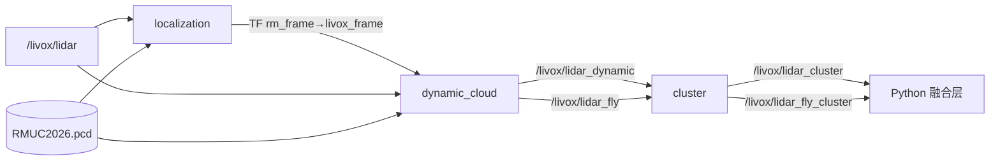

# 03 · 雷达管线：三个 ROS2 节点

`Lidar_ws` 里三个节点串成一条流水线，目标是把一帧原始点云压成「几个候选目标中心点」：



三个节点各自解决一个问题：

| 节点 | 解决什么 | 一句话算法 |
|---|---|---|
| `localization` | 雷达在哪 | 用实时点云和场地点云地图配准，求 `rm_frame → livox_frame` 变换 |
| `dynamic_cloud` | 哪些点是「活物」 | 转到场地系后，把与静态地图重合的点扣掉，剩下的就是动态点 |
| `cluster` | 有几个活物、在哪 | 把动态点做欧式聚类，每个类的质心就是一个候选目标 |

读代码入口：`Lidar_ws/src/localization/src/localization.cpp`、`dynamic_cloud/src/dynamic_cloud.cpp`、`cluster/src/cluster.cpp`。三个文件都不长（1550 / 758 / 284 行），可以完整读。

---

## 1. localization —— 点云配准

### 1.1 为什么需要它

雷达测到的点在 `livox_frame` 里。要把它们和相机投影、裁判坐标比较，必须先知道「雷达在场地里的位姿」。

这本来可以靠卷尺量 + 手工输入外参（`lidar_extrinsics.yaml`），但雷达站每天架设位置有偏差，所以系统用**点云配准**自动求精确位姿，手工外参只作为初值。

### 1.2 实际执行的配准链

配置 `backend: "gicp_ndt"`，一次完整配准是三级串联：

```text
实时点云 ROI 筛选 + 体素下采样(0.1m)
        ↓
持久背景栅格（保留每格最远点，多帧累积）
        ↓
GICP                      max_corr=2.0m, max_iter=10
   ↓ 提供初值
NDT coarse                resolution=0.5m, step=0.1, max_iter=30
   ↓ 提供初值
NDT fine                  resolution=0.2m, step=0.05, max_iter=30
   ↓
有限性检查 → 跳变检查 → 平滑 → 发布 TF
```

**为什么是 GICP→NDT 而不是直接 NDT？** 作者在 `docs/融合定位算法说明.md` 里自己解释了，这段值得抄下来看：

> GICP 经过大量实验能够提供了良好的初步位姿，但由于基于硬匹配的优化函数性质不够良好，匹配过程总会收敛在和实际点云平均相差 10-20cm 的位置。NDT 基于局部概率密度求取极大似然，其性质极其良好，但细粒度的 NDT 依赖初值。

翻译成一句：**GICP 擅长粗对齐但精度封顶在 10–20cm，NDT 精度高但容易掉进局部最优。所以用 GICP 当「粗定位器」，喂给两级 NDT 做精修。**

NDT 为什么分 coarse/fine 两级也是同一个道理：`resolution=0.5m` 的高斯体素收敛域大但精度低，`0.2m` 的精度高但只在初值足够好时才收敛。

### 1.3 关键参数（`Lidar_ws/.../config/params.yaml`）

| 参数 | 当前值 | 作用与调参后果 |
|---|---|---|
| `backend` | `gicp_ndt` | 可选 `gicp` / `ndt` / `gicp_ndt`；写错会直接抛异常拒绝启动 |
| `max_registration` | **1** | 一轮最多配准几次 |
| `registration_interval_sec` | 0.5 | 两次配准的最小间隔 |
| `stable_required_count` | 30 | 连续多少帧 fitness 达标才「锁定」 |
| `fitness_threshold` | 0.01 | 达标阈值，越小越严格 |
| `accept_unconverged_result` | `true` | **未收敛但数值有限也采用** |
| `enable_background_filter` | `true` | 用持久背景替代滑动累积 |
| `background_angular_bin_deg` | 0.1° | 背景栅格的角度分辨率 |
| `registration_reset_inlier_ratio_threshold` | 0.90 | 内点率低于此值判定雷达移动并重置 |
| `transform_smooth_alpha` | 0.35 | 位姿平滑系数 |
| `max_translation_jump` | 10.0 m | 允许的最大跳变（放宽是为了允许重置） |

### 1.4 一个必须注意的行为：`max_registration: 1`

这是读代码时最容易困惑的地方。看 `registrationFinishedLocked()`：

```cpp
return registration_count_ >= max_registration_ ||
       (has_aligned_ && !continuous_registration_);
```

配置是 `max_registration=1` + `continuous_registration=false`，所以：

- 系统**只做一次**完整的 GICP→NDT→NDT，之后永久停止配准。
- `stable_required_count=30` 实际上永远不会被满足（只跑了 1 次），`has_aligned_` 保持 `false`。
- 第一次配准 `has_registered_once_ == false`，所以**不做平滑**，最终位姿就是这一次的原始结果。
- 但 `background_grid_`（背景栅格）**仍然逐帧更新**，因为它和配准状态解耦。这是刻意的，见源码注释：

> 配准锁定、达到次数上限或 NDT 阶段达到迭代上限，都不应阻止背景继续吸收后续帧。

**这对使用者的含义**：雷达一旦架好、定位收敛，就认为位姿固定不变（这对固定架设的雷达站是合理假设）。如果比赛中间雷达被碰了，需要靠「内点率掉到 0.90 以下」自动触发重置，或者手动调服务：

```bash
ros2 service call /localization/reset_registration std_srvs/srv/Trigger "{}"
```

重置会 `epoch/generation +1`，让 worker 里正在跑但属于旧一轮的结果失效（`registrationWorkerLoop` 里的 `job.generation != registration_generation_` 检查）。

### 1.5 持久背景栅格：这个项目比较巧的设计

传统做法是「多帧累积再配准」，问题是**走近雷达的机器人会污染累积点云**，让配准被前景拖走。

这里的做法（`buildPersistentBackgroundSource()` + `updateBackgroundGrid()`）：

1. 把 ROI 内的点按 **方位角 × 俯仰角** 切成 `0.1°` 的栅格。
2. **每个栅格里只保留距离最远的那个点**。背后的假设是：同一视线方向上，最远的点通常是场地围栏/墙壁等静态背景，近处的是机器人。
3. 逐帧更新时，如果新观测比背景更近（`background_range_tolerance = 0.10m` 以内视为同一表面波动）→ 认为是遮挡，**不替换背景**。
4. 如果新观测显著更远，先记为「更远候选」，需要连续 `background_candidate_confirm_count` 次观测距离一致（容差 0.15m）才承认并替换。防止单个噪点污染背景。
   当前配置把这个次数设成了 **1**，即「一次更远观测就接受」——因为比赛场地背景相对干净，宁可快速跟上反而不想漏掉真实的场景变化。想更保守就调到 2~3。

这样一来，**前景机器人无论怎么跑，都不会把背景栅格改坏**，配准的点云源保持稳定。

### 1.6 输出与调试话题

- TF `rm_frame → livox_frame`：每个点云回调都发布一次当前位姿（`publishTF`）。
- `/livox/map`：静态地图，10 秒一次（RViz 用）。
- `/filter_map` 和 `/livox/registration_source`：**实际送进配准器的点云**。
  这是排查「配准为什么偏」的第一现场——在 RViz 里同时看 `/livox/map` 和 `/livox/registration_source`，重叠程度直接反映配准质量。

---

## 2. dynamic_cloud —— 动态点提取

`dynamic_cloud/src/dynamic_cloud.cpp`，入口 `callback()`。

### 2.1 处理步骤

```text
接收 /livox/lidar
  ↓ TF 查 rm_frame ← livox_frame   （失败 → 整帧丢弃）
  ↓ 手工剔除区域（飞镖区/基地/建模差异区）
  ↓ 判断是否在 main_roi 内
      ├─ 在主场地 → filtered_cloud（进入动态点检测）
      └─ 在主场地外 → 只保留飞镖/飞行器 ROI 内的点
  ↓ KD-Tree 最近邻：点到地图的距离² > 区域阈值 → 动态点
  ↓ 按 x 坐标分近/中/远三区，各自累积 N 帧
  ↓ 拼接后发布 /livox/lidar_dynamic
```

### 2.2 静态地图扣除

地图先体素下采样（`voxel_leaf_size=0.1m`）建 KD-Tree。对每个点 `p` 查最近邻 `q`：

```text
d² = ||p - q||²
d² > threshold(区域)  →  p 是动态点
```

**三个区域用不同阈值**，因为点云密度随距离下降、测量误差随距离上升：

| 区域 | 切分值（`region_split_axis: x`） | 阈值 |
|---|---|---|
| 近端 | `x ≤ 16.0` | 0.05 m² |
| 中间 | `16.0 < x ≤ 22.0` | 0.04 m² |
| 远端 | `x > 22.0` | 0.03 m² |

`near_region_positive: false` 表示坐标小的一端是近端——与雷达外参 `translation: [0.0, 6.5, 3.8]`（雷达在 x≈0 侧）一致。

### 2.3 分区累积（这一步影响精度）

| 区域 | 累积帧数 | 作者的理由 |
|---|---|---|
| 近端 | 3 | 近处点密，少累积可以减轻运动拖影 |
| 中间 | 6 | 折中 |
| 远端 | 6 | 远处点稀，多累积才能聚出稳定簇 |

**每个点只进入一个区域缓存**，避免目标跨分界时在两边重复计入、人为提高聚类密度（源码注释明确说明了这点）。

**累积带来的固有代价**：机器人高速移动时，累积点云会在运动方向上拉出拖尾，所以 `cluster` 算出的质心**不等于机器人的几何中心**，而是「过去 N 帧轨迹的加权中心」。这是这套系统融合时偏爱「用雷达点更新卡尔曼」而不是直接用雷达点当测量值的隐含原因之一——卡尔曼的平滑能吃掉一部分拖尾延迟。

### 2.4 顺带的告警检测

同一份点云还被用来做规则告警，发布 `RadarWarn` 到 `/lidar_detect`：

- 飞镖靶区点数 > `dart_min_points`(5) → `dart_state = 1`
- 飞行器安全区/预警区/报警区点数 > `fly_min_points`(40) → `fly_state = 1/2/3`

三个区域是同心扩大的 box，所以 `fly_state` 天然是「越来越接近」的严重程度分级。

### 2.5 代码里的死代码

`TransformCloud()` 这个全局函数（约 50 行，手写多线程变换）**没有被调用**——`callback` 里实际用的是 `pcl::transformPointCloud`。读到不用困惑，跳过即可。

---

## 3. cluster —— 欧式聚类

`cluster/src/cluster.cpp`，核心只有 `clusterAndPublish()` + `AppendClusterCenters()` 两个函数，是三个节点里最好懂的。

### 3.1 算法

```text
接收 /livox/lidar_dynamic
  ↓ 按 x 分成近/中/远三份（切分参数与 dynamic_cloud 完全一致）
  ↓ 每份独立跑 pcl::EuclideanClusterExtraction
  ↓ 每个聚类求算术质心
  ↓ 把质心当成一个个点发布 /livox/lidar_cluster
```

质心就是简单的算术平均：

```text
P_center = (1/N) · Σ P_i
```

### 3.2 参数

| 参数 | 近端 | 中间 | 远端 | 含义 |
|---|---|---|---|---|
| `*_cluster_tolerance` | 0.25 | 0.25 | 0.25 | 欧式距离容差（米） |
| `*_min_cluster_size` | 5 | 3 | 3 | 小于此点数丢弃 |
| `*_max_cluster_size` | 5000 | 5000 | 5000 | 大于此点数丢弃 |

近端 `min_size=5` 比远端严格，因为近端点密度更高——远处一个真实目标可能只有 3 个点。

**`max_cluster_size = 5000` 的实际作用**：过滤掉大块「非目标」动态点，比如场地里走动的人影、飘动的旗帜被误判为动态的大面积结构。

### 3.3 一个容易被忽略的语义

`/livox/lidar_cluster` 里的每个「点」其实是一个**聚类质心**，不是真实测量点。
所以 Python 侧收到的是「场上大概有这么几个候选目标，位置在这儿」，**完全不带身份信息，也不带点数/尺寸**。

这也解释了融合算法为什么必须依赖相机：单靠这条链路，系统只知道「有 4 个东西在动」，不知道是谁。

### 3.4 飞行目标走另一条路

`/livox/lidar_fly` 走同样的聚类流程，但输出到 `/livox/lidar_fly_cluster`，且：
- 用的是单独的 `flyCallback()`。
- 在 Python 侧**不经过身份匹配**，直接当作空中机器人位置使用（见 [06-融合状态机.md](06-融合状态机.md) 的输出部分）。

---

## 4. launch 与参数流

`rm2026_lidar_launch/launch/lidar_pipeline.launch.py` 是个 `OpaqueFunction` 风格的 launch：手写 YAML 读取，再把参数**逐项**塞给三个节点。这带来两个读代码时的注意点：

1. **launch 里的默认值和 yaml 里的值可能不一样**。例如 launch 里 `fitness_threshold` 默认 0.1，yaml 里写的是 0.01——以 yaml 为准，因为 `_build_actions` 优先读 yaml。
2. **改参数必须改 yaml**，不要改 launch 里的 `get(..., default)`，那些只是兜底。

启动时序（`startup_delay_sec: 2.0`）：

```text
t=0    localization 启动（加载地图、初始化配准器）
t=2s   dynamic_cloud + cluster 启动
```

延时的目的写在参数注释里：避免定位尚未就绪时产生大量把静态结构误判成动态点的无效输出。

## 5. 这一层出问题时怎么查

按这个顺序，能覆盖 90% 的情况：

| 现象 | 先看什么 |
|---|---|
| 完全没有 `/livox/lidar_cluster` | `ros2 topic hz /livox/lidar` 有没有数据；TF 是否存在 `ros2 run tf2_tools view_frames` |
| 聚类点满天飞（静态结构被当动态） | RViz 看 `/filter_map` 与 `/livox/map` 是否错位 → 定位偏了 |
| 聚类点太少/漏目标 | 看 `/livox/lidar_dynamic` 点密度；检查 `*_min_cluster_size` 和区域阈值 |
| 位置系统性偏移 10–20cm | 这是 GICP 的固有精度上限，检查是否真的走了 NDT 精修（看日志里的 `fine NDT` 那行） |
| 目标位置有拖尾延迟 | 累积帧数太大（近/中/远 3/6/6），或 `voxel_leaf_size` 过大 |

## 下一步

雷达给出了候选位置，接下来看相机怎么给出身份 → [04-视觉检测链路.md](04-视觉检测链路.md)
