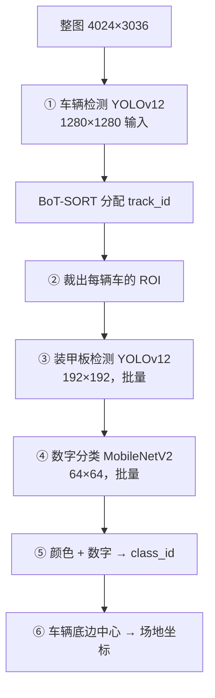

# 04 · 视觉检测链路

这篇讲：**一张 4024×3036 的图，怎么变成"这辆车是红方 3 号，置信度 0.83"这样的结构化观测。**

对应代码：`tracker/CascadeMatchTracker/detector.py`（462 行，建议完整读）、`model/armor_detector.py`、`model/digit_classifier/`、`model/yolov12/predictor.py`。

## 1. 为什么要两级检测

如果直接在整图上检测装甲板，会遇到两个问题：

1. 4024×3036 上有 10 个小装甲板，直接检测要么缩图丢细节，要么切片花费巨大。
2. 装甲板数量多且杂乱，误检率高。

所以拆成：



关键洞察：**装甲检测只需要在车辆 ROI 里做**（192×192 足够），这既提高了小目标的有效分辨率，又把 GPU 计算量降下来了。而且 ROI 是**批量**送进模型的——所有车辆的装甲板裁图拼成一个 batch，一次推理。

## 2. ① 车辆检测 + BoT-SORT

```python
# detector.py: detect_cars()  L246
car_detections, _ = self.car_detector.predict(img)
```

`car_detector` 是 `PredictorWithTracker`（`model/yolov12/predictor_with_tracker.py`），内部用 ultralytics 的 `model.track()`，把检测和 **BoT-SORT** 跟踪一次做完。

配置：

| 参数 | 值 | 说明 |
|---|---|---|
| `weights_path` | `weights/car/best.engine` | TensorRT engine |
| `img_size` | 1280 | 输入缩放尺寸 |
| `conf_thres` | 0.3 | 置信度阈值（可在 UI 里运行时调） |
| `iou_thres` | 0.5 | NMS IoU |
| `max_det` | 10 | **10 正好对应 10 台机器人** |
| `tracker_config_path` | `config/botsort.yaml` | 跟踪器参数 |

**BoT-SORT 在这里的作用不是"跟踪"，而是给每个检测框一个稳定的 `track_id`。**
它是跨帧的物体 ID（第 37 号框在这一帧和上一帧是同一辆车），后续用来建立「同一辆车的历史语义」。注意它和最终的"机器人身份 class_id"是两件不同的事——`track_id` 只表示"同一辆车"，不知道是哪台车。

`max_det: 10` 是个隐式约束：场上最多 10 台机器人（5 红 5 蓝），设成 10 意味着不允许出现第 11 个框。

**没有 track_id 的框会被直接丢弃**（`detector.py` L281：`if car_box is None or track_id is None: continue`）。这是有意为之——没有 ID 的框无法接入后续语义历史。

## 3. ② 裁 ROI（零拷贝）

```python
crop = img[y1:y2, x1:x2]        # numpy 切片，不复制数据
crop_view = crop.view()
crop_view.flags.writeable = False   # 冻结，防止下游意外修改原图
```

`CarStageItem.vehicle_roi` 是一个**只读视图**，指向原始大图的一块内存。A 阶段把它交给 B 阶段时不需要复制 1220 万像素，这是流水线能跑起来的重要前提。

## 4. ③④ 装甲 + 数字（两步检测）

当前配置 `armor_detector_type: "two_step"`，走 `TwoStepArmorDetectorClassifier`（`model/armor_detector.py` L114）。

### 4.1 第一步：装甲板位置 + 颜色

```python
raw_detections_list, _ = self.armor_detector_model.predict_batch(imgs)
# 每个 detection = (color_id, xyxy, confidence)
```

输入是整批车辆 ROI（`img_size: 192`），输出是**装甲框 + 颜色**。颜色模型只有 3 类：

| `color_id` | 含义 |
|---|---|
| 0 | 灰色 / 死亡 |
| 1 | 红色 |
| 2 | 蓝色 |

注意坐标是**相对该 ROI 的局部坐标**（`predictor.py` L132-133 用 `image.shape` 反缩放）。

### 4.2 第二步：数字分类

把所有车的所有装甲板裁图**合并成一个 batch**，转成 PIL RGB，送 MobileNetV2：

| 项 | 值 |
|---|---|
| 模型 | MobileNetV2（`weights/MobileNetv2.2.pth`） |
| 输入 | 64×64（`NormalTransform(input_size=64)`） |
| 预处理 | 黑边填充成正方形 → resize 64 → ImageNet 均值方差归一化 |
| 类别 | `["1", "2", "3", "4", "S", "Q"]` 共 6 类 |

类别含义（**这个映射很关键**）：

| index | 类名 | 对应机器人 |
|---|---|---|
| 0 | `1` | 英雄 |
| 1 | `2` | 工程 |
| 2 | `3` | 3 号步兵 |
| 3 | `4` | 4 号步兵 |
| 4 | `S` | 哨兵（装甲编号写作 7） |
| 5 | `Q` | 前哨站 |

`index 5`（前哨站）在 `predict_batch` 里被直接丢弃：

```python
if pattern_id == 5:  # 前哨站不进入机器人身份候选
    continue
```

配置里也有对应的 `ignored_digit_index: 5`，双重保险。

### 4.3 合成 15 类 class_id

这是整个视觉链路里最容易看不懂的一步（`_compose_armor_class_id` L134）：

```python
color_offsets = {0: 10, 1: 5, 2: 0}    # 灰 / 红 / 蓝
armor_id = pattern_id + offset
```

于是得到 15 类：

```text
pattern_id:  0    1    2    3    4
蓝 (offset 0):   B1   B2   B3   B4   B7     → class_id 0~4
红 (offset 5):   R1   R2   R3   R4   R7     → class_id 5~9
灰 (offset 10):  G1   G2   G3   G4   G7     → class_id 10~14
```

这个 `class_id` 是全系统的身份主键，必须与 `armor_detector.class_names` 的**固定顺序**完全一致——`tracker.py` 的 `_validate_config()` 里有断言，顺序错了直接拒绝启动：

```python
required_names = ["B1","B2","B3","B4","B7","R1","R2","R3","R4","R7","G1","G2","G3","G4","G7"]
if names != required_names:
    raise ValueError("armor_detector.class_names 必须与 15 类固定顺序完全一致")
```

**为什么需要"灰色"这一类？** 比赛里有「死亡状态」，装甲灯熄灭后是灰的。灰甲只能告诉你编号（比如"这是 1 号"），但**不能判断阵营**——`G1` 既可能是 `B1` 也可能是 `R1`。这个歧义是融合状态机里一整级匹配（灰甲模糊匹配）存在的原因。

## 5. ⑤ 置信度合成与装甲选择

### 5.1 组合置信度

一辆车可能检测出多个装甲板候选。每个候选的置信度是两项加权：

```text
C_combined = 0.70 × C_digit + 0.30 × C_armor
```

权重在 `params.yaml: digit_detector`：

| 参数 | 值 | 含义 |
|---|---|---|
| `digit_confidence_weight` | 0.70 | 数字分类权重 |
| `armor_confidence_weight` | 0.30 | 装甲检测权重 |
| `min_digit_confidence` | 0.30 | 数字置信度下限 |
| `min_combined_confidence` | 0.55 | 组合置信度下限 |

**为什么数字权重更高？** 因为颜色/位置错一两个像素无所谓，但数字认错就等于身份认错。数字是身份的唯一来源，所以给它更高权重。

### 5.2 选择最优装甲（`_select_armor()` L225）

```python
eligible = [obs for obs in observations
            if obs.digit_index != ignored_digit_index
            and obs.digit_confidence >= min_digit_confidence
            and obs.combined_confidence >= min_combined_confidence]
selected = max(eligible, key=(combined, digit, armor, -x1, -y1))
```

四个筛选/排序键，前三个是置信度，后两个 `-x1, -y1` 是**确定性 tie-break**（同分时选左上角那个），保证同一输入每次跑出同样结果——这是可复现性的细节。

### 5.3 但所有候选都会被保留

`SingleDetectionResult` 里同时存了两份：

- `selected_armor` —— 选中的那个（用于身份语义）。
- `armor_observations` —— **全部候选**（用于后续可能的扩展）。

融合层目前只读 `selected_armor`，但保留全集意味着未来可以改成"多装甲联合推断"，不需要重跑检测。

### 5.4 一个隐藏阈值：`colored_anchor_min_combined_confidence`

`params.yaml` 里还有两个"锚点"阈值，它们**不在检测阶段用，而在融合阶段用**：

| 参数 | 值 | 场景 |
|---|---|---|
| `colored_anchor_min_combined_confidence` | 0.30 | 彩色装甲可以作为身份锚点 |
| `gray_anchor_min_combined_confidence` | 0.40 | 灰色装甲可以作为身份锚点 |

彩色装甲门槛更低（0.30），因为彩色装甲直接确定了阵营+编号，信息量更大；灰甲有阵营歧义，所以要求更高置信度。这个逻辑在 [06-融合状态机.md](06-融合状态机.md) 里展开。

## 6. ⑥ 投影（这里只提一句）

投影发生在 `detect_armors` 的后半段：

```python
if selected is not None:
    pos_3d, projection_mode = self._project_car_box(car_box, frame_size)
```

取的是**车辆框底边中心**：

```text
u = (x1 + x2) / 2
v = y2
```

然后用射线和场地网格求交，得到三维场地坐标。这部分单独成篇：[05-像素到场地坐标.md](05-像素到场地坐标.md)。

注意一个容易误解的点：**投影点不是最终位置**。它只用来"筛选候选雷达点"，融合成功后位置来自雷达。

## 7. 退化路径：装甲模型崩了怎么办

`_pipeline_stage_b_worker()` 里这个 try/except 很重要：

```python
try:
    detections, _, armor_timings = self.tracker.detect_armors(...)
except Exception as error:
    detections = self.tracker.build_vehicle_only_detections(packet.cars, ...)
```

`build_vehicle_only_detections()` 造出的观测：
- `class_id = -1`（无身份）
- `selected_armor = None`（无语义）
- 但**保留 `car_box`、`car_conf`、`bot_id`**

于是状态机退化为"只知道有车、不知道是谁"，会走历史轨迹续接，而不是整个系统崩掉。这是比赛场景下很实用的设计。

## 8. 两个容易踩的坑

### 坑 1：`three_step` 路径其实是另一套模型

配置里有 `armor_detector_type: "two_step" | "three_step"`。

- `two_step`（当前）：YOLOv12 装甲检测器（直接输出颜色）+ MobileNet 数字分类。
- `three_step`：`model/pfa_yolov5/predictor.py` 的 `YOLOv5Detector` + `model/armor_light_classifier.py` 的 `ArmorClassifier`（用灯条几何 + 分类器判断颜色）。

`three_step` 会加载整个 YOLOv5 代码副本。**读代码时如果看到 `pfa_yolov5` 相关的 40 个文件，那是这条分支才用的**，当前配置不执行。

### 坑 2：`ignore` 与 `max_det` 的相互作用

`armor_detector.max_det: 4` 意味着**每辆车的 ROI 里最多保留 4 个装甲板**。一台车最多 4 个装甲面朝向雷达，正常够用；但如果检测器在这个 ROI 里产生了大量误检，真正的装甲可能被 NMS 顶掉。调这个参数时要意识到它是"每个 ROI"而不是"全图"。

## 9. 检测阶段的耗时结构

如果你在看性能（`get_timing_debug_text()`），检测阶段被编号成 03~09：

| 编号 | 内容 | 执行位置 |
|---|---|---|
| 03 | 车辆检测 + BoT-SORT | CPU + GPU |
| 03.2.1 / 03.2.2 / 03.2.3 | Ultralytics 预处理 / TensorRT 推理 / YOLO 后处理 | CPU→GPU / GPU / GPU |
| 03.2.4 | BoT-SORT 更新（ReID 当前关闭） | CPU |
| 04 | 车辆 ROI 生成 | CPU |
| 06 | 装甲板检测（含推理） | CPU+GPU |
| 07 | 装甲 ROI → PIL | CPU |
| 08 | 数字分类（含推理） | CPU+GPU |
| 09 | 语义组装 + 射线投影 | CPU |

调优时最常见的结论是：**09（射线投影）在启用 XY Map 后可以显著下降**，而 03/06/08 的瓶颈主要在 GPU 推理，只能靠换 engine 或降分辨率解决。见 [08-调试与验证.md](08-调试与验证.md)。

## 下一步

- 投影怎么算 → [05-像素到场地坐标.md](05-像素到场地坐标.md)
- 这些观测怎么和雷达点配对 → [06-融合状态机.md](06-融合状态机.md)
