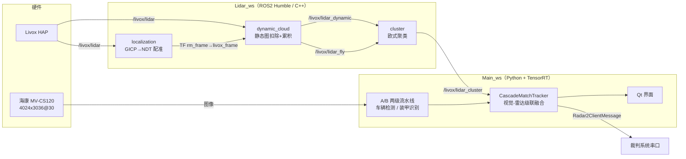

# 读这个开源：RM2026 相机 + 激光雷达融合定位

这是给「已经会 ROS2、懂计算机视觉，但第一次读这个仓库」的人准备的一套导读。
如果你**只会 OpenCV**，请先走 [basics/](basics/README.md)（路线 0）补齐点云、ROS2、
投影、深度学习检测、卡尔曼这些前置概念，再回来读本导读。
目标不是复述代码，而是回答三个问题：

1. **这套系统到底在干什么**（一句话：用相机给激光雷达点「贴上身份」）。
2. **它由哪几块组成、数据怎么流**（进程、线程、话题、状态机）。
3. **该按什么顺序读代码，哪几行是关键**。

## 一页纸全景



一句话概括算法：**雷达告诉你「场地平面上的 (x, y) 有东西」，相机告诉你「那是红方 3 号」，融合的任务就是把这两条信息在场地平面上对齐，并维持 10 个机器人的身份轨迹。**

## 阅读路线（按你的目的选一条）

### 路线 0：只会 OpenCV 的新手（2～4 天，先补预备知识）

| 顺序 | 文件 | 看完你应该能回答 |
|---|---|---|
| 1 | [basics/README.md](basics/README.md) + basics/01~05 | 点云、ROS2、坐标投影、YOLO/TensorRT、卡尔曼分别是什么、和 OpenCV 哪些概念同源 |
| 2 | [basics/06-动手实验.md](basics/06-动手实验.md) | 亲手跑通 7 个「项目模块最小复刻」实验（无需 ROS/GPU/雷达） |
| 3 | 回到下面的路线 A | 此时你已经具备读懂导读的全部前置概念 |

### 路线 A：先看懂架构（2～3 小时）

| 顺序 | 文件 | 看完你应该能回答 |
|---|---|---|
| 1 | [01-项目全景.md](01-项目全景.md) | 这个仓库包含什么、不包含什么、跑起来需要什么 |
| 2 | [02-架构与数据流.md](02-架构与数据流.md) | 有几个进程/线程、谁生产谁消费、一帧数据经历了什么 |
| 3 | [04-视觉检测链路.md](04-视觉检测链路.md) | A 阶段和 B 阶段分别做什么、为什么拆成两级 |
| 4 | [06-融合状态机.md](06-融合状态机.md) 的前 2 节 | 九个匹配阶段的大致分工 |
| 5 | 回看 `Main_ws/main_event_loop.py` | 代码能对上文档里的每个方框 |

### 路线 B：重点啃算法（1～2 天）

| 顺序 | 文件 | 关键代码 |
|---|---|---|
| 1 | [03-雷达管线三节点.md](03-雷达管线三节点.md) | `localization.cpp` / `dynamic_cloud.cpp` / `cluster.cpp` |
| 2 | [05-像素到场地坐标.md](05-像素到场地坐标.md) | `ray_renderer.py`、`solidwork2uwb.py` |
| 3 | [06-融合状态机.md](06-融合状态机.md) | `tracker.py`、`kalman.py`、`type.py` |
| 4 | [07-配置参数地图.md](07-配置参数地图.md) | 所有 yaml，边读边对照公式里的系数 |

### 路线 C：先跑起来再读（半天）

| 顺序 | 文件 | 说明 |
|---|---|---|
| 1 | [10-环境搭建.md](10-环境搭建.md) 的「完整构建流程」节 | 装 ROS2、Livox 驱动、conda 环境 |
| 2 | [08-调试与验证.md](08-调试与验证.md) | 用网盘回放数据，不接硬件也能看效果 |
| 3 | README 的「回放验证」 | 先 `--preflight-only`，再完整回放 |
| 4 | 回头按路线 A 读架构 | 有画面之后读代码效率高很多 |

## 这个仓库的一个「隐藏主线」

读的时候请始终抓住这条主线，否则容易被大量工程代码淹没：

```
雷达点只会给你位置，不会给你身份
        ↓
相机只会给你身份，不会给你准确位置（标定误差 + 地形模型误差）
        ↓
所以：用相机投影点的「位置近似」去筛选候选雷达点
        ↓
再用「身份三元组」互斥求解，保证一个身份 / 一辆车 / 一个雷达点只用一次
        ↓
匹配成功 → 用雷达点更新二维卡尔曼（位置可信）
匹配失败 → 降级：历史匈牙利 → 灰甲模糊 → 纯雷达猜 → 卡尔曼续航 → 固定点
```

这条主线就是 `tracker/CascadeMatchTracker/tracker.py::process_observations()` 里十个步骤的顺序，
也是整个项目最有设计感的地方。详见 [06-融合状态机.md](06-融合状态机.md)。

## 目录

| 文档 | 内容 |
|---|---|
| [basics/](basics/README.md) | **路线 0 · 新手预备篇**：只会 OpenCV 的话从这里开始——点云、ROS2、三维几何、深度学习检测、卡尔曼 + 7 个动手实验 |
| [01-项目全景.md](01-项目全景.md) | 项目定位、硬件、目录结构、开源边界、环境与构建 |
| [02-架构与数据流.md](02-架构与数据流.md) | 进程/线程模型、ROS2 话题表、A/B 流水线、时间一致性与退化规则 |
| [03-雷达管线三节点.md](03-雷达管线三节点.md) | 点云配准（GICP→NDT 两阶段 + 持久背景）、动态点提取、三分区聚类 |
| [04-视觉检测链路.md](04-视觉检测链路.md) | 车辆检测 + BoT-SORT、装甲两步检测、数字分类、15 类 class_id 的由来 |
| [05-像素到场地坐标.md](05-像素到场地坐标.md) | 相机模型、射线与场地 mesh 求交、XY Map 加速、红蓝阵营镜像 |
| [06-融合状态机.md](06-融合状态机.md) | 九级级联匹配、代价函数、三元组互斥求解、卡尔曼与退化策略 |
| [07-配置参数地图.md](07-配置参数地图.md) | 每个 yaml 在哪、哪个参数控制什么、改动会有什么后果 |
| [08-调试与验证.md](08-调试与验证.md) | 回放流程、RViz/TF 调试、耗时统计、在线残差统计、常见坑 |
| [09-术语表.md](09-术语表.md) | 中英文术语和缩写速查 |
| [10-环境搭建.md](10-环境搭建.md) | **完整运行环境**：系统、ROS2、ndt_omp、Livox、conda、MVS、TensorRT、构建与自检 |
| [11-迁移到Ubuntu2404.md](11-迁移到Ubuntu2404.md) | 在 24.04 + ROS2 Jazzy 上跑起来的逐步操作（改 4 个脚本 + 换 Python 3.12 + 重编） |
| [12-本机部署记录.md](12-本机部署记录.md) | 本机（CA016 相机 + Mid360 雷达）实际部署、标定现状与实测记录 |

## 阅读时请忽略的部分

仓库里有相当比例是「别人写的、不需要读」的代码，先跳过可以省很多时间：

- `Main_ws/model/pfa_yolov5/` —— 完整的 ultralytics YOLOv5 副本（约 40 个文件），只有 `predictor.py` 和启用 `three_step` 时才用到。当前配置走 `two_step`，这条路径默认不执行。
- `Main_ws/driver/hik_camera/MvImport/` —— 海康 MVS SDK 的 Python 厂商封装，几万行，当黑盒用。
- `Main_ws/model/yolov12/` —— 只是 ultralytics 的一层薄封装，看 `predictor.py` 的 `predict_batch()` 就够了。
- `Main_ws/tests/` —— 值得读的是 `test_cascade_match_tracker.py`（纯 CPU 状态机测试，不需要 GPU，是理解状态机最快的方式）。

## 一条建议

如果你只想用两个小时把「它为什么这么设计」弄明白，读这两段的注释就够了：

- `Main_ws/tracker/CascadeMatchTracker/tracker.py` 顶部 `CascadeMatchTracker` 的类注释 + `process_observations()` 的分段计时命名（`10.1` 到 `10.12`）。
- `docs/融合定位算法说明.md` 里作者自己写的「注：」（为什么放弃激进三元组、为什么保留 GICP 给 NDT 当初值）。

这些注释透露的设计取舍，比代码本身更有信息量。
