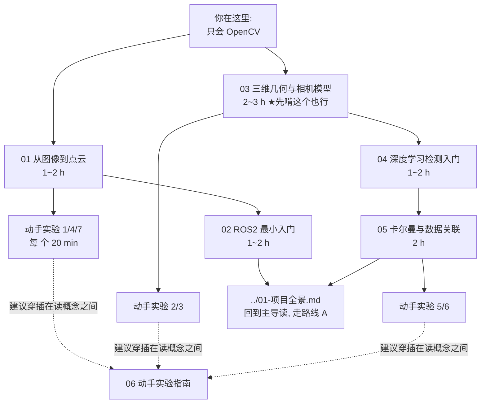

# 路线 0 · 只会 OpenCV 的新手预备篇

> `learning/` 里 01~12 那套导读，是写给「已经会 ROS2、懂计算机视觉」的人的。
> 如果你只会 OpenCV（会读写图、阈值、找轮廓、`solvePnP` 听说过），
> 直接读它会卡在 ROS2、点云、PCL、TensorRT、卡尔曼这些前置概念上。
> **这个文件夹就是给你补前置知识用的**——从你已经会的 OpenCV 概念出发，
> 一路桥接到本项目的每一块。

## 你已经会的，比你想的更有用

| 你会的 OpenCV 概念 | 项目里的对应（本套文档帮你接上） |
|---|---|
| 图像 = `H×W×3` 网格 | 点云 = `N×3` 无序点列表（基础 01） |
| `findContours` / `floodFill` 连通域 | 欧式聚类（基础 01 + 实验 4） |
| 背景扣除 MOG2 | 静态地图扣除动态点（基础 01） |
| 特征匹配 + `findHomography` | 点云配准 ICP/NDT（基础 01 + 实验 7） |
| `calibrateCamera` / `solvePnP` | 内外参、现场标定（基础 03 + 实验 3） |
| `filter2D` 卷积 | CNN 的卷积只是 kernel 改成学的（基础 04） |
| 单目标跟踪 CSRT | 卡尔曼 + 匈牙利多目标跟踪（基础 05 + 实验 5/6） |
| `python a.py` 单进程脚本 | ROS2 节点 / 话题通信（基础 02） |

## 阅读顺序与时间预算

| 顺序 | 文档 | 时长 | 一句话 |
|---|---|---|---|
| 1 | [01-从图像到点云.md](01-从图像到点云.md) | 1~2 h | 雷达世界的「图像学」 |
| 2 | [02-ROS2最小入门.md](02-ROS2最小入门.md) | 1~2 h | 进程间怎么说话，只学本项目需要的 |
| 3 | [03-三维几何与相机模型.md](03-三维几何与相机模型.md) | 2~3 h | 像素怎么变成米（全项目数学核心） |
| 4 | [04-深度学习检测入门.md](04-深度学习检测入门.md) | 1~2 h | YOLO/TensorRT/跟踪，够用为止 |
| 5 | [05-卡尔曼滤波与数据关联.md](05-卡尔曼滤波与数据关联.md) | 2 h | 融合层的心脏 |
| 6 | [06-动手实验.md](06-动手实验.md) | 2~3 h | 7 个可运行实验，边跑边回头读 |

总计约一个周末（10~14 小时，含实验）。每篇末尾有**自测题**，答不上来回看，
答得上就翻篇。

## 实验在哪里

[experiments/](experiments/) 目录，7 个自包含脚本，只需 `python3 + numpy + cv2 + scipy`，
在这台机器上已全部验证可跑（输出图在 `experiments/output/`）。
先跑**实验 1**（读项目真实场地 PLY、30 秒出图）最容易获得成就感。

## 读完之后

1. 回到 [../README.md](../README.md) 走「路线 A」（01→02→04→06 的项目导读），
   此时你已具备读懂它们的全部前置概念；
2. 用回放数据跑一次真实管线（不需要硬件）：`./run_replay_test.sh Main_ws/config/test.yaml --preflight-only`，
   详见 [06-动手实验.md](06-动手实验.md) 末节和 [../08-调试与验证.md](../08-调试与验证.md)；
3. 想在自己机器上把整套环境搭起来：[../10-环境搭建.md](../10-环境搭建.md)、
   [../11-迁移到Ubuntu2404.md](../11-迁移到Ubuntu2404.md)、[../12-本机部署记录.md](../12-本机部署记录.md)。

## 这套文档不讲什么

- 不讲 C++/PCL 的 API 细节（会用直觉 + 对照表代替，真到写代码时查文档）；
- 不讲深度学习训练（本项目只做推理，模型是训练好的）；
- 不重复 `learning/01~12` 已写透的项目细节——每篇会在结尾把你交还回去。
